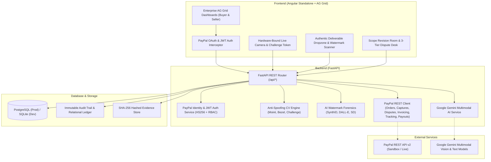
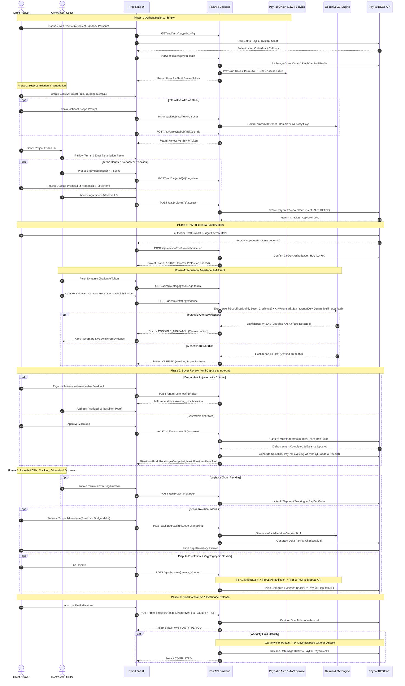

# ProofLens 🛡️
> **Intelligent Milestone Escrow & AI Forensic Verification Engine**  
> *Engineered for the PayPal Hackathon 2026*

ProofLens is an enterprise-grade escrow and milestone fulfillment platform designed for high-value contractor agreements, custom artisan fabrication (bespoke carpentry, fine jewelry, architectural renovation), and digital agency deliverables. ProofLens bridges **PayPal Escrow Checkout & Milestone Disbursements** with **Zero-Dependency Anti-Spoofing Computer Vision**, **Google Gemini Multimodal Vision**, and **Generative AI Watermark Forensics**.

---

## 📑 Table of Contents
- [Executive Overview](#-executive-overview)
- [System Architecture](#-system-architecture)
- [Key Features & Pillars](#-key-features--pillars)
  - [1. PayPal OAuth2 Identity & Enterprise Session Security](#1-paypal-oauth2-identity--enterprise-session-security)
  - [2. PayPal Escrow & Multi-Capture Disbursement Engine](#2-paypal-escrow--multi-capture-disbursement-engine)
  - [3. Extended PayPal FinTech APIs (Tracking, Refunds, Invoicing & Payouts)](#3-extended-paypal-fintech-apis-tracking-refunds-invoicing--payouts)
  - [4. Zero-Dependency Anti-Spoofing Computer Vision & Challenge Tokens](#4-zero-dependency-anti-spoofing-computer-vision--challenge-tokens)
  - [5. Generative AI Watermark & Provenance Forensics](#5-generative-ai-watermark--provenance-forensics)
  - [6. Gemini Multimodal Verification & Interactive AI Legal Assistant](#6-gemini-multimodal-verification--interactive-ai-legal-assistant)
  - [7. Sequential Milestone Enforcement, Resubmission & Contractor Alerts](#7-sequential-milestone-enforcement-resubmission--contractor-alerts)
  - [8. Multi-Tier Dispute Desk, Evidence Dossier & Dynamic Warranty Protection](#8-multi-tier-dispute-desk-evidence-dossier--dynamic-warranty-protection)
- [Tech Stack](#-tech-stack)
- [Project Structure](#-project-structure)
- [Prerequisites](#-prerequisites)
- [Installation & Quick Start](#-installation--quick-start)
  - [1. Backend Setup (FastAPI)](#1-backend-setup-fastapi)
  - [2. Frontend Setup (Angular)](#2-frontend-setup-angular)
- [Environment Configuration & Production Readiness](#-environment-configuration--production-readiness)
- [End-to-End Platform Flow](#-end-to-end-platform-flow)
- [Recent Hardening & Architecture Remediation](#-recent-hardening--architecture-remediation)
- [Running Automated Tests](#-running-automated-tests)
  - [Backend Test Suite (28 Modules, 99 Unit & Integration Tests)](#backend-test-suite-28-modules-99-unit--integration-tests)
  - [Frontend Test Suite (Node.js Test Runner)](#frontend-test-suite-nodejs-test-runner)
- [Security & Secrets Hygiene](#-security--secrets-hygiene)
- [License & Acknowledgements](#-license--acknowledgements)

---

## 🌟 Executive Overview
In modern high-trust contracting, payment disputes occur when deliverables cannot be verified reliably. Contractors face arbitrary payment delays and unilateral chargebacks, while buyers face fraudulent submissions—such as photos taken of phone screens, recycled internet assets, unverified locations, or unauthorized synthetic AI generations passed off as handmade craft or custom digital design.

**ProofLens resolves this impasse with cryptographic escrow gates:**
1. **Financial Security via PayPal**: Escrow funds are secured upfront using PayPal Orders (`intent: AUTHORIZE`). Funds are released on a strictly milestone-by-milestone basis via PayPal Payments Captures (`final_capture = False` for intermediate stages, `final_capture = True` for the conclusion).
2. **PayPal OAuth2 Single Sign-On**: Authentication is grounded directly in verified PayPal identities via the PayPal Identity API, issuing signed JWT (HS256) bearer session tokens and enforcing strict Buyer vs. Seller Role-Based Access Control (RBAC).
3. **Anti-Spoofing CV Engine**: Zero-dependency Python computer vision analyzes camera captures for high-frequency Moiré wave interference patterns, rainbow subpixel chromatic shifts, visible phone/monitor bezels, and enforces dynamic physical challenge tokens.
4. **AI Watermark Forensics**: Digital deliverables are inspected for synthetic generative signatures, including Google SynthID, OpenAI DALL-E, Midjourney, Stable Diffusion, ComfyUI, NovelAI, and Adobe Firefly metadata.
5. **Physical & Digital Domain Awareness**: Physical milestones verify EXIF GPS geofences and hardware-bound camera timestamps; digital milestones audit repository commits, URLs, and file streams.
6. **Sequential Milestone Protection**: Milestones must be completed in order. Milestone $N+1$ cannot receive submissions until Milestone $N$ is verified and approved.
7. **Extended PayPal FinTech Suite**: Fully integrates PayPal Invoicing v2 (with HTML receipts & QR codes), PayPal Order Tracking API, Payments Capture Refunds, Real-Time Balance/Ledger Search, and PayPal Payouts for matured retainage.
8. **Multi-Tier Dispute Resolution**: Escrowed funds are protected by a 3-tier escalation desk: Tier 1 bilateral negotiation, Tier 2 programmatic AI mediation, and Tier 3 human arbitration with compiled cryptographic evidence dossiers synchronized with PayPal Disputes API.

---

## 🏛️ System Architecture



---

## ⚡ Key Features & Pillars

### 1. PayPal OAuth2 Identity & Enterprise Session Security
- **Log in with PayPal**: User authentication is anchored directly to PayPal accounts via `/api/auth/paypal-config` and `/api/auth/paypal-login`, exchanging authorization codes for verified PayPal user identity profiles.
- **One-Click Sandbox Personas**: Rapid switching between pre-configured sandbox roles (`Buyer / Client` and `Contractor / Seller`) for testing and demonstration workflows.
- **JWT HS256 Session Tokens**: Authoritative cryptographically signed bearer tokens issued upon successful PayPal authentication containing user claims (`sub`, `email`, `role`, `exp`).
- **Angular Auth Interceptor**: Seamless client-side interceptor (`auth.interceptor.ts`) that transparently attaches JWT Bearer tokens to all API requests.
- **Role-Based Access Control (RBAC)**: Strict server-side route guards separating buyer actions (`BUYER_ONLY_ROUTES`) from contractor actions (`SELLER_ONLY_ROUTES`).

### 2. PayPal Escrow & Multi-Capture Disbursement Engine
- **Upfront Escrow Hold**: Places a 29-day authorization hold on the client's PayPal account (`POST /v2/checkout/orders` with `intent: AUTHORIZE`).
- **Sequential Multi-Capture**: Milestones disburse funds independently (`POST /v2/payments/authorizations/{id}/capture`). Intermediate milestones specify `final_capture = False`, reserving remaining funds for subsequent milestones.
- **Deferred Retainage Protection**: Configurable retainage hold (e.g. 10%) withheld until final milestone signoff or warranty period conclusion.
- **Unilateral & Mutual Voiding**: Buyers can unilaterally void escrow if a seller ghosts before work commences (`POST /api/escrow/{project_id}/void`); mutual consent releases authorization holds instantly via `POST /api/escrow/{project_id}/void-request` and response workflows.
- **Authorization Re-authorization & FUNDS_AT_RISK Safeguard**: Built-in support for extending 29-day authorization windows (`POST /api/payments/{project_id}/reauthorize` and automated cron). When renewal is required or at risk, projects transition to `FUNDS_AT_RISK` with immediate buyer re-approval alerts.
- **Webhook Synchronization**: Validates and processes PayPal webhook events (`PAYMENT.AUTHORIZATION.CREATED`, `PAYMENT.CAPTURE.COMPLETED`, `CUSTOMER.DISPUTE.CREATED`).

### 3. Extended PayPal FinTech APIs (Tracking, Refunds, Invoicing & Payouts)
- **PayPal Invoicing v2 Integration**: Automatically creates, sends, and marks compliant milestone invoices as paid upon successful capture (`paypal_service.create_and_finalize_milestone_invoice`). Features official printable HTML receipt views and invoice QR codes.
- **PayPal Order Tracking API**: Contractors can attach logistics and shipping tracking data (`POST /api/projects/{project_id}/track`) directly to the PayPal order, including carrier name, tracking number, and status (`SHIPPED` / `DELIVERED`).
- **Payments Capture Refunds**: Supports partial or full capture refunds via PayPal Payments v2 (`POST /api/escrow/{project_id}/refund`).
- **Live PayPal Balances & Transaction Search**: Real-time financial ledger modal in the Seller Dashboard querying PayPal Balances (`GET /api/paypal/balances`) and Transaction Search API (`GET /api/paypal/transactions`).
- **Automated Retainage Payouts**: Automatically disburses held retainage funds upon expiration of the warranty period using the PayPal Payouts API (`POST /api/warranty/process-matured-payouts`).

### 4. Zero-Dependency Anti-Spoofing Computer Vision & Challenge Tokens
- **Moiré Interference Detection**: Fast Fourier Transform (FFT) and high-frequency gradient oscillation math identify pixel grid interference caused by photographing another monitor or phone screen.
- **Rainbow Chromatic Dispersion**: Analyzes subpixel RGB spatial dispersion patterns that only occur on backlit electronic displays.
- **Bezel & Frame Edge Detection**: Scans image borders for monitor frames, smartphone bezels, and handheld screen reflections.
- **Dynamic Physical Challenge Tokens**: Issues real-time dynamic challenge tokens (`GET /api/projects/{project_id}/challenge-token`) requiring the contractor to perform a live physical gesture or display a dynamic code in-frame to defeat pre-recorded re-broadcast attacks.
- **Hardware-Bound Camera Constraints**: Mobile camera viewfinder requests `facingMode: { exact: 'environment' }` to enforce physical rear lenses and prevent synthetic virtual webcams.
- **Location Geofencing & Baseline Exemption**: Validates EXIF/device GPS coordinates against project site coordinates (`verify_physical_evidence_location`), with baseline before-evidence requirements for renovations and formal exemption declarations for scratch builds.
- **Tamper Quarantine**: Submissions flagged with screen spoofing drop to $\le 20\%$ confidence, locking escrow disbursement until genuine, live direct proof is supplied.

### 5. Generative AI Watermark & Provenance Forensics
- **Deep Signature Stream Inspection**: Audits binary file streams for embedded AI generator metadata tags (`SynthID`, `deepmind_watermark`, `dall-e`, `midjourney`, `parameters\x00`, `stablediffusion`, `comfyui`, `novelai`, `firefly`).
- **Visual Generative Badge Scanning**: Inspects corner regions for DALL-E multi-color swatches, Midjourney watermark stamps, or AI generator logos.
- **Authentic Craftsmanship Guarantee**: Flags synthetic digital submissions passed off as handmade artisan work or bespoke digital illustration.

### 6. Gemini Multimodal Verification & Interactive AI Legal Assistant
- **Interactive AI Drafting Desk**: Conversational AI assistant (`/api/projects/{project_id}/draft-chat` & `/finalize-draft`) interviews the buyer to establish scope, industry type, domain, deadlines, and milestone allocations.
- **Domain & Warranty Period Detection**: Automatically classifies projects as physical vs. digital (simple digital = 0 days, complex software = 7 days, physical = 14 days) to dynamically configure retainage hold durations.
- **Multimodal Visual Audit**: Google Gemini evaluates uploaded proof against milestone specifications, comparing physical features, dimensions, material quality, and completion percentages.
- **AI Agreement Regeneration**: Rewrites terms, evidence requirements, and milestone criteria based on revised bilateral negotiation notes (`POST /api/projects/{project_id}/regenerate-agreement`).
- **AI Scope Addenda Generator**: When project scope evolves, Gemini drafts formal Version $N+1$ Addenda, updates deadlines, and computes incremental PayPal funding links.

### 7. Sequential Milestone Enforcement, Resubmission & Contractor Alerts
- **Strict Execution Order**: Milestone $N+1$ is strictly locked until Milestone $N$ has been verified, approved, and partially captured.
- **Buyer Feedback & Resubmission**: Buyers can reject unsatisfactory proof with specific, actionable critique. The milestone shifts to `awaiting_resubmission` without resetting the entire project.
- **Batch Evidence Submissions**: Supports multi-angle or multi-part proof uploads in a single batch (`POST /api/projects/{project_id}/evidence-batch`).
- **Proactive Contractor Alerts**: Dedicated alerts center (`GET /api/contractor/active-alerts`) notifying contractors of milestone rejections, feedback, scope changes, and expiring escrow holds.
- **Contractor Agreement Rejection**: Contractors can reject draft agreements with an explicit reason (`POST /api/projects/{project_id}/reject`), updating project status and notifying the buyer.
- **Immutable Audit Trail**: All previous evidence submissions, rejection reasons, and timestamped forensic reports remain preserved.

### 8. Multi-Tier Dispute Desk, Evidence Dossier & Dynamic Warranty Protection
- **Tier 1 — Direct Negotiation**: In-app negotiation room allows buyer and seller to exchange counter-proposals, remedies, or pivot to an amicable scope change.
- **Tier 2 — Programmatic AI Mediation**: Gemini evaluates historical milestone evidence, agreement terms, and dispute claims to classify dispute types and recommend objective compromise.
- **Tier 3 — PayPal Dispute Escalation & Cryptographic Dossier**: Formal escalation synchronizes case data with PayPal Customer Disputes API (`/v1/customer/disputes`), pushing a compiled evidence dossier (`GET /api/disputes/{project_id}/dossier`) containing agreement versions, SHA-256 evidence digests, and forensic reports.
- **Post-Completion Warranty Period**: Dynamic warranty hold (e.g. 7–30 days) safeguards buyers against latent defects, with automated retainage payout via PayPal Payouts once matured without disputes.

---

## 🛠️ Tech Stack

| Layer | Technologies |
|---|---|
| **Frontend** | Angular (v19/v20 Standalone Components), TypeScript, RxJS, AG Grid Community (`ag-grid-angular`), HTML5 Canvas Live Camera, CSS3 / SCSS (Corporate PayPal Navy Palette) |
| **Backend** | Python 3.9+, FastAPI, Uvicorn, Pydantic v2, HTTPX, SQLAlchemy |
| **Authentication** | PayPal OAuth2 (Sandbox / Live Identity API), PyJWT (HS256 tokens), Role-Based Access Control (RBAC middleware) |
| **Database** | PostgreSQL (Production Mandatory); SQLite (Local isolated development only) |
| **AI & Vision** | Google Gemini Multimodal Vision API (`gemini-4-argon`, `gemini-3.8-flash`, `gemini-flash-latest`), Custom Zero-Dependency Python CV Engine (Moiré FFT & Bezel Math) |
| **Payments** | PayPal REST API v2 (Orders v2 Authorize, Payments v2 Multi-Capture, Reauthorization, Voids, Refunds, Invoicing v2, Customer Disputes v1, Order Tracking, Payouts v1, Webhooks) |
| **Testing** | Python `unittest` discovery runner (28 modules, 99 tests), Node.js native test runner (`node --test`) |

---

## 📂 Project Structure

```
ProofLens/
├── backend/
│   ├── main.py                     # Primary FastAPI application, REST endpoints, CV & Watermark engines
│   ├── auth_service.py             # PayPal OAuth session management & JWT HS256 auth
│   ├── ai_service.py               # Gemini prompt orchestration & addendum generator
│   ├── database.py                 # SQLAlchemy engine, session factory & migration guards
│   ├── models.py                   # Relational database models (User, Project, Agreement, Evidence, Dispute, etc.)
│   ├── paypal_service.py           # PayPal REST Client: Orders, Captures, Invoicing, Disputes, Tracking, Payouts
│   ├── requirements.txt            # Python dependencies
│   ├── .env.example                # Sanitized backend environment template
│   └── test_*.py                   # 28 automated unit & integration test modules
├── frontend/
│   ├── src/
│   │   ├── app/
│   │   │   ├── api.config.ts            # Centralized API configuration & runtime base URL resolver
│   │   │   ├── auth.interceptor.ts      # Automatic JWT Bearer token attachment
│   │   │   ├── paypal-oauth.service.ts  # PayPal OAuth2 client flow & token handling
│   │   │   ├── evidence-file.service.ts # Safe deliverable preview & download service
│   │   │   ├── project-warranty.utils.ts# Domain-aware warranty calculation helpers
│   │   │   ├── runtime-config.mjs       # Environment-aware API origin resolver & sanitization
│   │   │   ├── runtime-config.test.mjs  # Automated frontend unit test suite (Node test runner)
│   │   │   ├── buyer-dashboard/         # AG Grid buyer contracts, KPI metrics & project setup
│   │   │   ├── seller-dashboard/        # AG Grid seller overview, PayPal balances & active alerts
│   │   │   ├── buyer-wizard/            # Interactive project creation & AI contract wizard
│   │   │   ├── seller-invite/           # Project invitation acceptance & onboarding
│   │   │   ├── negotiation-room/        # Bilateral contract terms, milestone editing & AI drafting
│   │   │   ├── milestone-fulfillment/   # Milestone timeline, review desk, invoicing & proof dropzone
│   │   │   ├── revision-room/           # Scope change addenda desk & delta funding authorization
│   │   │   ├── dispute-room/            # 3-Tier dispute desk, AI mediation & dossier viewer
│   │   │   ├── live-camera/             # Hardware-bound live camera with dynamic challenge tokens
│   │   │   └── login/                   # PayPal OAuth2 login & sandbox persona switcher
│   │   ├── index.html
│   │   ├── main.ts
│   │   └── styles.css                   # PayPal Corporate Navy design system
│   ├── angular.json
│   ├── package.json
│   └── tsconfig.json
├── uploads/                        # Hashed evidence storage (gitignored, kept via .gitkeep)
├── .gitignore                      # Security exclusions (secrets, venv, databases, node_modules)
├── .env.example                    # Root environment configuration guide
└── README.md                       # Comprehensive platform documentation
```

---

## 📋 Prerequisites
Before running ProofLens, ensure you have:
- **Node.js**: `v18.x` or `v20.x`
- **npm**: `v9.x` or higher
- **Python**: `v3.9` to `v3.12`
- **PayPal Developer Account**: Sign up at [developer.paypal.com](https://developer.paypal.com/) to obtain Sandbox Client ID & Secret.
- **Google Gemini API Key**: Obtain a key from [Google AI Studio](https://aistudio.google.com/).
- **PostgreSQL**: Required for staging/production deployments (SQLite is supported for local development).

---

## 🚀 Installation & Quick Start

### 1. Backend Setup (FastAPI)

1. Navigate to the backend directory:
   ```bash
   cd backend
   ```

2. Create and activate a Python virtual environment:
   ```bash
   python3 -m venv venv
   source venv/bin/activate
   # On Windows: venv\Scripts\activate
   ```

3. Install dependencies:
   ```bash
   pip install -r requirements.txt
   ```

4. Configure your environment variables:
   ```bash
   cp .env.example .env
   ```
   *Edit `.env` with your PayPal Sandbox credentials, Gemini API key, and JWT secret.*

5. Start the backend server:
   ```bash
   uvicorn main:app --reload --host 0.0.0.0 --port 8000
   ```
   - **Interactive API Docs (Swagger UI)**: [http://localhost:8000/docs](http://localhost:8000/docs)
   - **Health & DB Verification Endpoint**: [http://localhost:8000/api/health](http://localhost:8000/api/health)

---

### 2. Frontend Setup (Angular)

1. Open a new terminal and navigate to the frontend directory:
   ```bash
   cd frontend
   ```

2. Install npm dependencies:
   ```bash
   npm install
   ```

3. Launch the Angular development server:
   ```bash
   npm start
   # or: npx ng serve --port 4200
   ```

4. Open your browser and navigate to:
   ```
   http://localhost:4200
   ```

---

## 🔐 Environment Configuration & Production Readiness

### Production Environment Invariants
Production deployments (`APP_ENV=production`) enforce strict operational rules:
- **Database Selection**: A reachable PostgreSQL `DATABASE_URL` is mandatory. The application will refuse to start if SQLite is configured in production.
- **Fail-Fast Migrations**: `run_migrations()` raises a `RuntimeError` immediately upon encountering schema anomalies rather than failing silently.
- **PayPal Real Endpoints**: Enforces HTTPS `PAYPAL_API_BASE=https://api-m.paypal.com`. All simulated/fake payment fallbacks are completely disabled in production.
- **Security Tokens**: `JWT_SECRET_KEY` and `ADMIN_API_TOKEN` must be at least 32 characters in length.
- **Frontend Origin Security**: `FRONTEND_URL` and `PAYPAL_REDIRECT_URI` must use HTTPS without wildcards or localhost references.

### Environment Variables Reference
All configuration variables are centralized in [`backend/.env.example`](backend/.env.example). Copy this template to `backend/.env` and supply your environment-specific credentials:
- **PayPal Sandbox**: Obtain `PAYPAL_CLIENT_ID`, `PAYPAL_CLIENT_SECRET`, and `PAYPAL_WEBHOOK_ID` from the [PayPal Developer Dashboard](https://developer.paypal.com/). Set `PAYPAL_REDIRECT_URI` to your frontend callback.
- **AI Vision**: Generate a `GEMINI_API_KEY` from [Google AI Studio](https://aistudio.google.com/).
- **Database**: Set `DATABASE_URL` (PostgreSQL is required in production; SQLite is used automatically for local testing).
- **Authentication**: Set a 32+ character random `JWT_SECRET_KEY` and `ADMIN_API_TOKEN`.
- **Uploads Storage**: Set `UPLOADS_DIR` to a persistent directory volume.

---

## 🔄 End-to-End Platform Flow

The complete project lifecycle from user authentication to final escrow release follows this sequence:



---

## 🛡️ Recent Hardening & Architecture Remediation

ProofLens underwent a comprehensive production readiness overhaul:

1. **PayPal Identity & Session Security**:
   - Integrated **Log in with PayPal (PayPal OAuth2)** to bind user accounts directly to verified financial identities (`/api/auth/paypal-config` & `/api/auth/paypal-login`).
   - Implemented persistent **JWT HS256** access token issuance with automatic token attachment in Angular (`auth.interceptor.ts`).
   - Configured robust Role-Based Access Control (RBAC) route middleware separating buyer and contractor endpoints.
2. **Database Integrity & Fail-Fast Migrations**:
   - `backend/database.py` enforces PostgreSQL in production mode (`APP_ENV=production`).
   - Schema migrations fail-fast with explicit `RuntimeError` rather than logging silent warnings.
3. **PayPal Gateway Protection**:
   - Eliminated all fake mock success responses from production codepaths in `backend/paypal_service.py`.
   - Enforced HTTPS live API endpoints and live credential validation.
   - Built extended integrations: **PayPal Invoicing v2**, **Order Tracking**, **Customer Disputes v1**, **Capture Refunds**, and **PayPal Payouts**.
4. **Zero-Dependency Anti-Spoofing & AI Forensics**:
   - Implemented native Moiré FFT math, chromatic subpixel dispersion analysis, and bezel detection in `main.py`.
   - Added real-time dynamic challenge tokens (`/api/projects/{project_id}/challenge-token`) and rear-camera enforcement.
   - Created digital AI watermark forensics inspecting file streams and corner badges for SynthID, DALL-E, Midjourney, and Stable Diffusion.
5. **Interactive UI & Runtime Verification**:
   - Deployed **AG Grid Community** enterprise grids across Buyer and Seller dashboards for real-time project metrics and PayPal ledger tracking.
   - Built environment-aware runtime configuration (`runtime-config.mjs`) with automated unit tests via Node.js test runner (`runtime-config.test.mjs`).

---

## 🧪 Running Automated Tests

### Backend Test Suite (28 Modules, 99 Unit & Integration Tests)

The backend features an extensive test suite verifying all payment, computer vision, AI, and workflow logic:

```bash
cd backend
USE_LOCAL_DB=true \
APP_ENV=test \
ALLOW_INSECURE_TEST_AUTH=1 \
ALLOW_SIMULATED_WEBHOOKS=1 \
ALLOW_SIMULATED_PAYPAL_FAILURES=1 \
PYTHONPATH=. \
SKIP_GEMINI_NETWORK=1 \
./venv/bin/python -m unittest discover -s . -p 'test_*.py'
```

#### Core Test Modules:
- **`test_defect_2_2_escrow_checkout.py`**: Verifies PayPal Orders v2 `AUTHORIZE` escrow hold lifecycle.
- **`test_multi_capture_and_reauth.py`**: Verifies milestone-based partial captures with `final_capture = False` and authorization renewal.
- **`test_digital_ai_watermark.py`**: Verifies SynthID, DALL-E, Midjourney, and Stable Diffusion synthetic generative watermark forensics.
- **`test_ai_model_upgrade.py`**: Verifies Gemini multimodal vision analysis, Moiré FFT math, and screen bezel detection.
- **`test_dispute_workflow.py`**: Verifies 3-tier dispute escalation (bilateral negotiation, AI mediation, PayPal dispute synchronization).
- **`test_scope_changes.py`**: Verifies Gemini addenda drafting, deadline adjustments, and delta funding lifecycle.
- **`test_scope_change_rejection.py`**: Verifies contractor and buyer rejection of proposed scope modifications.
- **`test_contractor_rejection.py`**: Verifies contractor rejection of draft agreements with reason tracking.
- **`test_location_tracking.py`**: Verifies EXIF/GPS geofence matching and digital deliverable exemption logic.
- **`test_milestone_invoicing.py`**: Verifies automated PayPal Invoicing v2 creation, payment recording, and HTML receipt rendering.
- **`test_paypal_extended_apis.py`**: Verifies PayPal Order Tracking, capture refunds, balances lookup, and void operations.
- **`test_reauthorize_and_funds_at_risk.py`**: Verifies 29-day authorization renewal, auto-reauthorize cron, and `FUNDS_AT_RISK` flagging.
- **`test_void_escrow_and_notifications.py`**: Verifies mutual-consent void escrow requests and real-time in-app notification routing.
- **`test_dynamic_warranty_and_dispute.py`**: Verifies domain-aware warranty duration calculation and retainage disbursement holds.
- **`test_completed_dispute_void_and_invoices.py`**: Verifies dispute resolution and final milestone invoicing behavior.

### Frontend Test Suite (Node.js Test Runner)

Run the automated frontend test suite:

```bash
cd frontend
npm test
```

*Runs 6 automated unit tests validating API base URL resolution, trailing slash trimming, HTTPS protocol security, stored user token parsing, and third-party credential leakage protection.*

Verify TypeScript type compilation:
```bash
cd frontend
npx tsc --noEmit
```

---

## 🔒 Security & Secrets Hygiene

1. **Zero Secret Leakage**: `.gitignore` strictly prevents `.env`, `*.db`, and uploaded user assets from entering git history.
2. **Backend-Only PayPal Secret**: PayPal client secrets and access tokens are strictly managed by FastAPI; the frontend never receives payment credentials.
3. **Cryptographic Asset Integrity**: All uploaded evidence artifacts are digested with SHA-256 upon ingestion and recorded in an immutable ledger.
4. **Secure Headers & CORS**: FastAPI and Angular runtime configs sanitize API base URLs, enforcing HTTPS in production.

---

## 👥 License & Acknowledgements
- **Engineered by**: ProofLens Engineering Team
- **Competition**: PayPal Hackathon 2026
- **License**: [MIT License](LICENSE)
