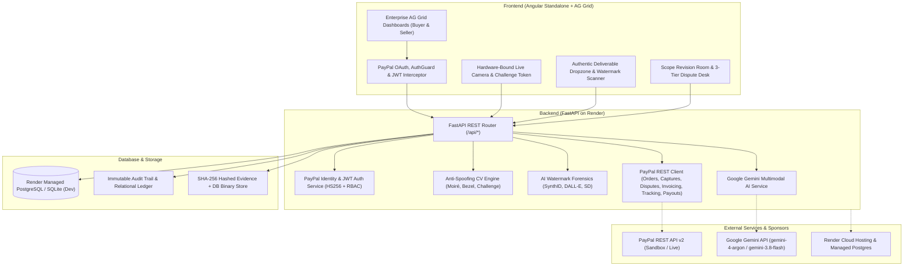
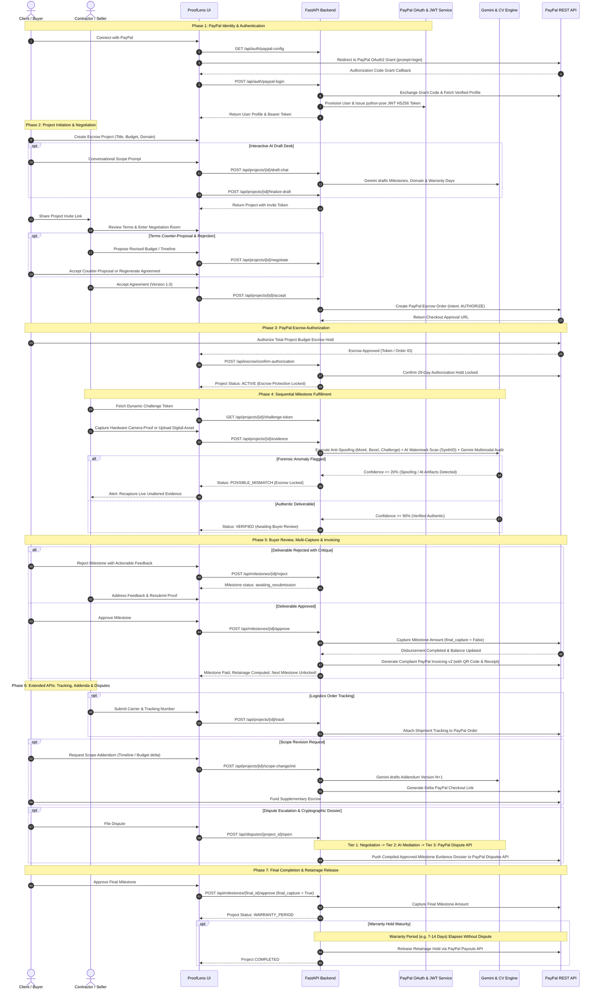

# ProofLens 🛡️
> **Intelligent Milestone Escrow & AI Forensic Verification Engine**  
> *Engineered during the PayPal Hackathon 2026 (New Hackathon Submission)*

- **Live Web App (Vercel)**: [https://pay-pal-hackathon-phi.vercel.app](https://pay-pal-hackathon-phi.vercel.app)
- **Live Backend API & Swagger Docs (Render)**: [https://paypal-hackathon-backend.onrender.com/docs](https://paypal-hackathon-backend.onrender.com/docs)
- **Public Repository**: [https://github.com/sahi26/PayPal---Hackathon](https://github.com/sahi26/PayPal---Hackathon)

ProofLens is a new enterprise-grade escrow and milestone fulfillment platform built during the hackathon submission period for high-value contractor agreements, custom artisan fabrication (bespoke carpentry, fine jewelry, architectural renovation), and digital agency deliverables. ProofLens bridges **PayPal Escrow Checkout, Multi-Capture Disbursements, Invoicing & Disputes** with **Zero-Dependency Anti-Spoofing Computer Vision**, **Google Gemini Multimodal AI**, and **Generative AI Watermark Forensics**.

---

## 📑 Table of Contents
- [Executive Overview](#-executive-overview)
- [System Architecture](#-system-architecture)
- [Key Features & Pillars](#-key-features--pillars)
  - [1. PayPal OAuth2 Identity & Enterprise Session Security](#1-paypal-oauth2-identity--enterprise-session-security)
  - [2. PayPal Escrow & Multi-Capture Disbursement Engine](#2-paypal-escrow--multi-capture-disbursement-engine)
  - [3. Extended PayPal FinTech APIs (Tracking, Refunds, Invoicing & Payouts)](#3-extended-paypal-fintech-apis-tracking-refunds-invoicing--payouts)
  - [4. Zero-Dependency Anti-Spoofing Computer Vision & Challenge Tokens](#4-zero-dependency-anti-spoofing-computer-vision--challenge-tokens)
  - [5. Generative AI Watermark & Provenance Forensics](#5-generative-ai-watermark--provenance-forensics)
  - [6. Gemini Multimodal Verification & Interactive AI Legal Assistant](#6-gemini-multimodal-verification--interactive-ai-legal-assistant)
  - [7. Sequential Milestone Enforcement, Resubmission & Contractor Alerts](#7-sequential-milestone-enforcement-resubmission--contractor-alerts)
  - [8. Multi-Tier Dispute Desk, Evidence Dossier & Dynamic Warranty Protection](#8-multi-tier-dispute-desk-evidence-dossier--dynamic-warranty-protection)
- [Tech Stack & Integrations](#-tech-stack--integrations)
  - [PayPal Developer Platform Tools & Usage](#paypal-developer-platform-tools--usage)
  - [AI & Forensic Verification Stack](#ai--forensic-verification-stack)
  - [Sponsor Tool Integrations (AG Grid & Render)](#sponsor-tool-integrations-ag-grid--render)
- [Project Structure](#-project-structure)
- [Prerequisites](#-prerequisites)
- [Installation & Quick Start](#-installation--quick-start)
  - [1. Backend Setup (FastAPI)](#1-backend-setup-fastapi)
  - [2. Frontend Setup (Angular)](#2-frontend-setup-angular)
  - [3. Judge & Sandbox Testing Instructions](#3-judge--sandbox-testing-instructions)
- [Environment Configuration & Production Readiness](#-environment-configuration--production-readiness)
- [End-to-End Platform Flow](#-end-to-end-platform-flow)
- [Recent Hardening & Architecture Remediation](#-recent-hardening--architecture-remediation)
- [Running Automated Tests](#-running-automated-tests)
  - [Backend Test Suite (Python Unittest)](#backend-test-suite-python-unittest)
  - [Frontend Test Suite (Node.js Test Runner)](#frontend-test-suite-nodejs-test-runner)
- [Security & Secrets Hygiene](#-security--secrets-hygiene)
- [License & Acknowledgements](#-license--acknowledgements)

---

## 🌟 Executive Overview
In modern high-trust contracting, payment disputes occur when deliverables cannot be verified reliably. Contractors face arbitrary payment delays and unilateral chargebacks, while buyers face fraudulent submissions—such as photos taken of phone screens, recycled internet assets, unverified locations, or unauthorized synthetic AI generations passed off as handmade craft or custom digital design.

**ProofLens resolves this impasse with cryptographic escrow gates:**
1. **Financial Security via PayPal**: Escrow funds are secured upfront using PayPal Orders (`intent: AUTHORIZE`). Funds are released strictly milestone-by-milestone via PayPal Payments Captures (`final_capture = False` for intermediate stages, `final_capture = True` for the conclusion).
2. **PayPal OAuth2 Single Sign-On**: Authentication is grounded directly in verified PayPal identities via the PayPal Identity API (`prompt=login`), issuing `python-jose` signed JWT (HS256) session tokens alongside Angular route guards (`authGuard`) and bfcache/history protections.
3. **Anti-Spoofing CV Engine**: Zero-dependency Python computer vision analyzes camera captures for high-frequency Moiré wave interference patterns, rainbow subpixel chromatic shifts, visible phone/monitor bezels, and enforces dynamic physical challenge tokens.
4. **AI Watermark Forensics**: Digital deliverables are inspected for synthetic generative signatures, including Google SynthID, OpenAI DALL-E, Midjourney, Stable Diffusion, ComfyUI, NovelAI, and Adobe Firefly metadata.
5. **Physical & Digital Domain Awareness**: Physical milestones verify EXIF GPS geofences and hardware-bound camera timestamps; digital milestones audit repository commits, URLs, and file streams.
6. **Sequential Milestone Protection**: Milestones must be completed in order. Milestone $N+1$ cannot receive submissions until Milestone $N$ is verified and approved.
7. **Extended PayPal FinTech Suite**: Integrates PayPal Invoicing v2 (with printable HTML receipts & QR codes), PayPal Orders v2 Shipment Tracking, Payments Capture Refunds, Real-Time Balance/Transaction Search, and PayPal Payouts for matured warranty retainage.
8. **Multi-Tier Dispute Resolution**: Escrowed funds are protected by a 3-tier escalation desk: Tier 1 bilateral negotiation, Tier 2 programmatic AI mediation, and Tier 3 PayPal Claim escalation backed by compiled Approved-Milestone Forensic Evidence Dossiers synchronized with PayPal Disputes API.

---

## 🏛️ System Architecture



---

## ⚡ Key Features & Pillars

### 1. PayPal OAuth2 Identity & Enterprise Session Security
- **Log in with PayPal**: User authentication is anchored directly to PayPal accounts via `/api/auth/paypal-config` and `/api/auth/paypal-login`, forcing fresh PayPal authentication (`prompt=login`) and exchanging authorization codes for verified PayPal identity profiles.
- **JWT HS256 Session Tokens**: Signed bearer tokens (`python-jose`) issued upon successful PayPal authentication containing user claims (`sub`, `email`, `role`, `exp`).
- **Angular Auth Guard & Navigation Hardening**: Client-side `authGuard`, `authInterceptor`, `Cache-Control: no-store` headers (`vercel.json`, `index.html`), and `pageshow`/`popstate` bfcache checks prevent unauthenticated access or post-logout back-navigation history leaks.
- **Role-Based Access Control (RBAC)**: Strict server-side route guards separating buyer actions (`BUYER_ONLY_ROUTES`) from contractor actions (`SELLER_ONLY_ROUTES`).

### 2. PayPal Escrow & Multi-Capture Disbursement Engine
- **Upfront Escrow Hold**: Places a 29-day authorization hold on the client's PayPal account (`POST /v2/checkout/orders` with `intent: AUTHORIZE`).
- **Sequential Multi-Capture**: Milestones disburse funds independently (`POST /v2/payments/authorizations/{id}/capture`). Intermediate milestones specify `final_capture = False`, reserving remaining funds for subsequent milestones.
- **Deferred Retainage Protection**: Configurable retainage hold (e.g. 10%) withheld until final milestone signoff or warranty period conclusion.
- **Unilateral & Mutual Voiding**: Buyers can unilaterally void escrow if a seller ghosts before work commences (`POST /api/escrow/{project_id}/void`); mutual consent releases authorization holds cleanly via `POST /api/escrow/{project_id}/void-request` and response workflows.
- **Authorization Re-authorization & `FUNDS_AT_RISK` Safeguard**: Supports extending 29-day authorization windows (`POST /api/payments/{project_id}/reauthorize` and automated cron `/api/payments/auto-reauthorize-cron`), transitioning expiring holds to `FUNDS_AT_RISK` with buyer re-approval alerts.
- **Webhook Synchronization**: Cryptographically validates and processes PayPal webhook events (`PAYMENT.AUTHORIZATION.CREATED`, `PAYMENT.CAPTURE.COMPLETED`, `CUSTOMER.DISPUTE.CREATED/UPDATED/RESOLVED`).

### 3. Extended PayPal FinTech APIs (Tracking, Refunds, Invoicing & Payouts)
- **PayPal Invoicing v2 Integration**: Automatically creates, publishes, and records payment against compliant milestone invoices upon capture (`create_and_finalize_milestone_invoice`), including official printable HTML receipts and base64 QR codes.
- **PayPal Orders v2 Tracking API**: Contractors can attach carrier, tracking number, and fulfillment status (`SHIPPED` / `DELIVERED`) directly to the funded PayPal order (`POST /api/projects/{project_id}/track`).
- **Payments Capture Refunds**: Supports partial or full capture refunds via PayPal Payments v2 (`POST /api/escrow/{project_id}/refund`).
- **Live PayPal Balances & Transaction Search**: Real-time financial ledger modal in the Seller Dashboard querying PayPal Balances (`GET /api/paypal/balances`) and Transaction Search API (`GET /api/paypal/transactions`).
- **Automated Retainage Payouts**: Disburses matured retainage funds after the warranty window closes without disputes using the PayPal Payouts API (`POST /api/warranty/process-matured-payouts`).

### 4. Zero-Dependency Anti-Spoofing Computer Vision & Challenge Tokens
- **Moiré Interference Detection**: Fast Fourier Transform (FFT) and high-frequency gradient oscillation math identify pixel grid interference caused by photographing another monitor or phone screen.
- **Rainbow Chromatic Dispersion**: Analyzes subpixel RGB spatial dispersion patterns that only occur on backlit electronic displays.
- **Bezel & Frame Edge Detection**: Scans image borders for monitor frames, smartphone bezels, and handheld screen reflections.
- **Dynamic Physical Challenge Tokens**: Issues real-time challenge tokens (`GET /api/projects/{project_id}/challenge-token`) requiring live capture of physical verification cues to defeat replay attacks.
- **Hardware-Bound Camera Constraints**: Mobile camera viewfinder requests rear physical camera optics (`facingMode: { exact: 'environment' }`) to avoid virtual camera injection.
- **Location Geofencing & Baseline Exemption**: Validates EXIF/device GPS coordinates against project site coordinates (`verify_physical_evidence_location`), with baseline before-evidence requirements for renovations and formal exemption declarations for scratch builds.
- **Tamper Quarantine**: Submissions flagged with screen spoofing drop to $\le 20\%$ confidence, locking escrow disbursement until genuine live proof is supplied.

### 5. Generative AI Watermark & Provenance Forensics
- **Deep Signature Stream Inspection**: Audits binary file streams for embedded AI generator metadata tags (`SynthID`, `deepmind_watermark`, `dall-e`, `midjourney`, `parameters\x00`, `stablediffusion`, `comfyui`, `novelai`, `firefly`).
- **Visual Generative Badge Scanning**: Inspects corner regions for DALL-E multi-color swatches, Midjourney watermark stamps, or AI generator logos.
- **Authentic Craftsmanship Guarantee**: Flags synthetic digital submissions passed off as handmade artisan work or bespoke digital illustration.

### 6. Gemini Multimodal Verification & Interactive AI Legal Assistant
- **Interactive AI Drafting Desk**: Conversational AI assistant (`/api/projects/{project_id}/draft-chat` & `/finalize-draft`) interviews the buyer to establish scope, industry type, domain, deadlines, and milestone allocations.
- **Domain & Warranty Period Detection**: Classifies projects as physical vs. digital (simple digital = 0 days, complex software = 7 days, physical = 14 days) to configure retainage hold durations dynamically.
- **Multimodal Visual Audit**: Google Gemini evaluates uploaded proof against milestone specifications, comparing physical features, dimensions, material quality, and completion percentages.
- **AI Agreement Regeneration**: Rewrites terms, evidence requirements, and milestone criteria based on revised bilateral negotiation notes (`POST /api/projects/{project_id}/regenerate-agreement`).
- **AI Scope Addenda Generator**: When project scope evolves, Gemini drafts formal Version $N+1$ Addenda, updates deadlines, and computes incremental PayPal funding links.

### 7. Sequential Milestone Enforcement, Resubmission & Contractor Alerts
- **Strict Execution Order**: Milestone $N+1$ is strictly locked until Milestone $N$ has been verified, approved, and partially captured.
- **Buyer Feedback & Resubmission**: Buyers can reject unsatisfactory proof with specific, actionable critique. The milestone shifts to `awaiting_resubmission` without resetting the entire project.
- **Batch Evidence Submissions**: Supports multi-angle or multi-part proof uploads in a single batch (`POST /api/projects/{project_id}/evidence-batch`).
- **Proactive Contractor Alerts**: Dedicated alerts center (`GET /api/contractor/active-alerts`) notifying contractors of milestone rejections, feedback, scope changes, and expiring escrow holds.
- **Contractor Agreement Rejection**: Contractors can reject draft agreements with an explicit reason (`POST /api/projects/{project_id}/reject`), updating project status and notifying the buyer.
- **Immutable Audit Trail**: All previous evidence submissions, rejection reasons, and timestamped forensic reports remain preserved.

### 8. Multi-Tier Dispute Desk, Evidence Dossier & Dynamic Warranty Protection
- **Tier 1 — Direct Negotiation**: In-app negotiation room allows buyer and seller to exchange counter-proposals, remedies, or pivot to an amicable scope change.
- **Tier 2 — Programmatic AI Mediation**: Gemini evaluates contractual scope, dispute claims, and **only accepted proofs from buyer-approved milestones (`APPROVED_MILESTONES_ONLY`)**—avoiding false `fraud` flags on subjective tolerance/color claims or rejected upload drafts.
- **Tier 3 — PayPal Dispute Escalation & Cryptographic Dossier**: Formal escalation synchronizes case data with PayPal Customer Disputes API (`/v1/customer/disputes`), compiling and exporting a full printable/PDF Forensic Dossier (`GET /api/disputes/{project_id}/dossier`) containing full contractual baseline terms, visual evidence previews, and SHA-256 hashes—supporting escalation even after an initial dispute was mutually marked resolved.
- **Post-Completion Warranty Period**: Dynamic warranty hold (e.g. 7–14 days) safeguards buyers against latent defects, with automated retainage payout via PayPal Payouts once matured without disputes.

---

## 🛠️ Tech Stack & Integrations

| Layer | Technologies & Versions |
|---|---|
| **Frontend** | Angular (`^19.0.0` Standalone Components), TypeScript (`~5.6.2`), RxJS (`~7.8.0`), **AG Grid (`ag-grid-angular` & `ag-grid-community` `^33.3.2`)**, Angular Material (`^19.2.19`), Lucide Icons, HTML5 Canvas Live Camera, CSS3 / SCSS |
| **Backend** | Python 3.9+, FastAPI (`>=0.110.0`), Uvicorn, SQLAlchemy 2.0, Pydantic v2 (`email`), HTTPX (`>=0.28.0`) |
| **Authentication** | **Log in with PayPal (OAuth2 / OIDC)**, Bcrypt (`4.0.1`, 12 salt rounds), `python-jose` (HS256 JWT tokens), RBAC Route Middleware, Angular `authGuard` |
| **Database & Hosting** | **Render** (Managed **PostgreSQL** + FastAPI Web Service) in production; Vercel (Angular SPA edge hosting); SQLite (local isolated dev/testing) |
| **AI & Vision** | **Google Gemini Multimodal AI** (`google-generativeai>=0.8.0` using `gemini-4-argon` primary + `gemini-3.8-flash` fallback), Zero-Dependency Python + Pillow Computer Vision (Moiré FFT, Bezel Scan), Generative AI Watermark Scanner |
| **Payments & Financial APIs** | **PayPal Developer Platform (Sandbox & Live REST APIs)**: Identity v1 (Log in with PayPal), Orders v2 (Authorize + Shipment Tracking), Payments v2 (Multi-Capture, Reauthorize, Void, Refund), Invoicing v2 (Draft/Send/Payment/QR), Customer Disputes v1 (List, Evidence Dossier, Claim Escalation), Payouts v1, Transaction Search v1, Webhooks v1 |
| **Testing** | Python `unittest` suite (28 backend test files), Node.js native test runner (`node --test src/app/*.test.mjs`, 12 frontend unit tests) |

### PayPal Developer Platform Tools & Usage

ProofLens uses PayPal not merely as a checkout button, but as a programmable **multi-stage escrow, identity, invoicing, fulfillment tracking, and dispute adjudication rail**:

| PayPal Tool / API | Endpoints Integrated | How ProofLens Uses It |
|---|---|---|
| **Log in with PayPal (Identity / OAuth2 & OIDC)** | `GET /api/auth/paypal-config`, `POST /v1/oauth2/token`, `GET /v1/identity/oauth2/userinfo?schema=paypalv1.1` (+ OIDC `id_token` validation) | Authenticates Buyers and Contractors directly via PayPal Sandbox/Live OAuth2 (`openid profile email` + `prompt=login`), assigns role-scoped accounts (`buyer` / `seller`), and issues signed `python-jose` JWT session tokens ([`paypal_oauth_login`](backend/main.py), [`get_paypal_oauth_config`](backend/main.py)). |
| **PayPal Orders API v2 (Escrow Hold)** | `POST /v2/checkout/orders` (`intent: AUTHORIZE`), `GET /v2/checkout/orders/{id}`, `POST /v2/checkout/orders/{id}/authorize` | Locks the full project budget in a non-custodial 29-day PayPal authorization hold upon buyer checkout approval (`create_order_for_authorize`, `authorize_order`) rather than settling funds upfront. |
| **PayPal Payments API v2 (Multi-Capture, Reauthorize, Void, Refund)** | `POST /v2/payments/authorizations/{id}/capture`, `POST .../reauthorize`, `POST .../void`, `POST /v2/payments/captures/{id}/refund` | • **Multi-Capture**: Releases funds strictly milestone-by-milestone upon buyer approval (`final_capture: false` for intermediate steps; `true` or retainage hold at completion).<br>• **Reauthorization**: Renews expiring 29-day holds (`reauthorize_payment`) to prevent `FUNDS_AT_RISK`.<br>• **Void & Refund**: Supports mutual voiding, 48h unilateral buyer void on contractor ghosting (`void_authorization`), and captured milestone refunds (`refund_capture`). |
| **PayPal Invoicing API v2 & QR Codes** | `POST /v2/invoicing/generate-next-invoice-number`, `POST /v2/invoicing/invoices`, `POST .../send`, `POST .../payments`, `POST .../generate-qr-code` | Automatically creates, numbers, publishes, marks as `PAID` with the escrow capture reference & SHA-256 evidence hash, and generates scannable base64 PNG QR codes for every approved milestone disbursement (`create_and_finalize_milestone_invoice`). |
| **PayPal Customer Disputes API v1** | `GET /v1/customer/disputes`, `GET /v1/customer/disputes/{id}`, `POST .../provide-evidence`, `POST .../escalate` | Lists/syncs linked PayPal disputes (`PP-D-*`), pushes ProofLens's compiled Approved-Milestone Forensic Evidence Dossier (`PROOF_OF_FULFILLMENT` with contractual baseline + SHA-256 proof hashes) directly to PayPal, and supports Tier 3 escalation to a 20-day PayPal Claim (`/escalate`). |
| **PayPal Package Tracking (Orders v2 Track)** | `POST /v2/checkout/orders/{order_id}/track` | Attaches carrier, tracking number, and fulfillment status (`SHIPPED` / `DELIVERED`) onto funded physical-domain escrow orders (`add_order_tracking` via `POST /api/projects/{project_id}/track`). |
| **PayPal Payouts API v1** | `POST /v1/payments/payouts` | Supports warranty-period retainage disbursements (`create_payout`) upon expiration of the post-completion inspection window. |
| **PayPal Transaction Search & Balances API v1** | `GET /v1/reporting/balances`, `GET /v1/reporting/transactions` | Powers the Contractor Desk's real-time PayPal Available / Withheld balance KPI card and interactive PayPal Activity & Ledger modal (`get_paypal_balances`, `get_paypal_transactions`). |
| **PayPal Webhooks & Signature Verification v1** | `POST /v1/notifications/verify-webhook-signature` (`/api/webhooks/paypal`) | Cryptographically verifies PayPal webhook headers & payloads (`PAYMENT.*`, `CUSTOMER.DISPUTE.CREATED`, `CUSTOMER.DISPUTE.UPDATED`, `CUSTOMER.DISPUTE.RESOLVED`) to keep local escrow and dispute states synchronized in real time. |

### AI & Forensic Verification Stack

- **Google Gemini AI (`backend/ai_service.py`)**: Powered by `google-generativeai` (`gemini-4-argon` primary with automatic fallback chain `gemini-3.8-flash` -> `gemini-3-flash-preview` -> `gemini-flash-latest`):
  - *Interactive Contract & Milestone Drafting*: Interviews the buyer to convert project descriptions into structured milestones with measurable verification criteria and dynamic warranty periods (0 days simple digital, 7 days complex software, 14 days physical craftsmanship/renovation).
  - *Multimodal Deliverable Audit*: Evaluates submitted milestone photos, URLs, and files against contractual requirements to flag mismatches, incomplete work, or fulfilled criteria with confidence scoring.
  - *Scope Addendum Co-Pilot*: Drafts formal Version $N+1$ contract addenda for mid-project budget/timeline revisions and calculates supplemental PayPal checkout deltas.
  - *Objective Dispute Classification*: Distinguishes normal buyer/seller specification disputes (`quality_defect` / `scope_mismatch`) from genuine media spoofing, evaluating **only accepted proofs from buyer-approved milestones (`APPROVED_MILESTONES_ONLY`)** and generating full printable/PDF Dossiers with contractual terms and embedded visual evidence.
- **Zero-Dependency Computer Vision & Watermark Scanner (`backend/main.py`)**:
  - Custom Python + `Pillow` FFT Moiré frequency analysis, subpixel RGB chromatic dispersion checks, border bezel detection, dynamic physical challenge token verification, EXIF/GPS geofencing, and binary/corner scanning for generative AI watermarks (`SynthID`, DALL-E, Midjourney, Stable Diffusion, ComfyUI, NovelAI, Firefly).

### Sponsor Tool Integrations (AG Grid & Render)

#### 1. AG Grid (`ag-grid-angular` & `ag-grid-community` v33.3.2)
ProofLens uses **AG Grid** across both primary financial workspaces—**Buyer Console** (`frontend/src/app/buyer-dashboard/`) and **Contractor Desk** (`frontend/src/app/seller-dashboard/`)—to render real-time, filterable, sortable, and paginated Escrow Contract Registers (`ag-theme-quartz` + custom fintech styling in `frontend/src/styles.css`):
- **Modular Registration & Responsive Layout**: Imports `AgGridAngular` and registers `AllCommunityModule` via `ModuleRegistry.registerModules([AllCommunityModule])`, configured with `[domLayout]="'autoHeight'"`, resizable/sortable `defaultColDef`, interactive pagination (`[10, 25, 50]` rows per page), and custom vector navigation icons (`gridIcons`).
- **Custom Fintech Cell Renderers**:
  - *Escrow ID*: Monospace `#PL-<id>` badge chips (`JetBrains Mono`).
  - *Interactive Project Scope*: Displays title, industry tag badge, and dispatches `openScopeDrawer` / `sellerOpenScopeDrawer` custom window events on click to open an inline full-specification & milestone inspection drawer.
  - *Financial & Status Indicators*: Formatted USD currency badges, color-coded Escrow Status pills (`IN NEGOTIATION`, `ACCEPTED & FUNDED`, `AWAITING ESCROW`, `ESCROW COMPLETED`), contract Version badges (`v1.0+`), counterparty avatar chips, and `Due:` deadline callouts.
  - *Role-Scoped Workflow Actions*: Dynamically renders `Open Room`, `Fulfillment`, `Copy Link`, `Terms`, `Submit Proof`, `View Summary`, and guarded delete buttons wired to Angular Router navigation and modals.

#### 2. Render (Managed Cloud Hosting & PostgreSQL Database)
ProofLens uses **Render** as the cloud runtime and database platform for the FastAPI backend ([`https://paypal-hackathon-backend.onrender.com`](https://paypal-hackathon-backend.onrender.com/docs)):
- **Production FastAPI Web Service & SPA Proxy**: Serves the REST API (`uvicorn main:app`), Swagger UI (`/docs`), PayPal OAuth/Webhook endpoints, and Gemini AI/CV orchestration pipelines. The Angular frontend deployed on Vercel ([`https://pay-pal-hackathon-phi.vercel.app`](https://pay-pal-hackathon-phi.vercel.app)) routes `/api/*` requests directly to Render via `vercel.json`, `frontend/vercel.json`, `frontend/src/index.html`, and `frontend/src/app/api.config.ts`.
- **Render Managed PostgreSQL (`backend/database.py`)**:
  - Enforces PostgreSQL in production (`APP_ENV=production`) with fail-fast connection pooling (`pool_size=15`, `max_overflow=20`, `pool_pre_ping=True`, `run_migrations()`).
  - Automatically normalizes Render's `postgres://` connection string prefix to SQLAlchemy 2.0's required `postgresql://` scheme.
- **Ephemeral-Disk-Safe Evidence Persistence (`backend/models.py` & `backend/main.py`)**:
  - Render web services use ephemeral local disks across deploys and restarts. To guarantee milestone photos, baseline captures, and dispute dossier previews remain downloadable long-term, ProofLens persists uploaded binary artifacts (up to 15 MB) in PostgreSQL `Evidence.file_data` (`BYTEA`) alongside filesystem caching in `UPLOAD_DIR`, transparently restoring and streaming files via `/api/evidence/download/{filename}`.

---

## 📂 Project Structure

```
ProofLens/
├── backend/
│   ├── main.py                     # Primary FastAPI application, REST endpoints, CV & Watermark engines
│   ├── auth_service.py             # Bcrypt + python-jose JWT HS256 auth & RBAC helpers
│   ├── ai_service.py               # Gemini prompt orchestration & addendum generator
│   ├── database.py                 # Render postgres://->postgresql:// engine, pooling & migration guards
│   ├── models.py                   # SQLAlchemy models (User, Project, Agreement, Evidence, Dispute)
│   ├── paypal_service.py           # PayPal OAuth2, Orders, Captures, Invoicing, Disputes, Tracking, Payouts
│   ├── requirements.txt            # Python dependencies
│   ├── .env.example                # Sanitized backend environment template
│   └── test_*.py                   # 28 automated unit & integration test modules
├── frontend/
│   ├── src/
│   │   ├── app/
│   │   │   ├── api.config.ts                # Render backend origin wiring & runtime URL resolver
│   │   │   ├── auth.guard.ts                # Route protection guard preventing unauthenticated access
│   │   │   ├── auth.interceptor.ts          # Automatic JWT Bearer attachment & 401 redirect handling
│   │   │   ├── paypal-oauth.service.ts      # PayPal OAuth2 client flow & token exchange
│   │   │   ├── evidence-file.service.ts     # Authenticated deliverable preview & download service
│   │   │   ├── project-warranty.utils.ts    # Domain-aware warranty calculation helpers
│   │   │   ├── runtime-config.mjs           # Environment-aware API origin resolver & sanitization
│   │   │   ├── scope-change-navigation.mjs  # One-time scope-change modal navigation helpers
│   │   │   ├── *.test.mjs                   # Automated frontend unit test suites (12 tests)
│   │   │   ├── buyer-dashboard/             # AG Grid Buyer Console & 3-step AI project wizard
│   │   │   ├── seller-dashboard/            # AG Grid Contractor Desk, alerts & PayPal live balance ledger
│   │   │   ├── buyer-wizard/                # Interactive project creation & AI contract wizard
│   │   │   ├── seller-invite/               # Project invitation acceptance & onboarding
│   │   │   ├── negotiation-room/            # Bilateral contract terms, milestone editing & AI drafting
│   │   │   ├── milestone-fulfillment/       # Milestone timeline, invoices, tracking & proof dropzone
│   │   │   ├── revision-room/               # Scope change addenda desk & delta funding authorization
│   │   │   ├── dispute-room/                # 3-Tier dispute desk, Dossier viewer & PDF export
│   │   │   ├── live-camera/                 # Hardware-bound live camera with dynamic challenge tokens
│   │   │   └── login/                       # PayPal OAuth2 login UI & role selection
│   │   ├── index.html                       # Runtime Render API config & no-cache security headers
│   │   ├── main.ts
│   │   └── styles.css                       # PayPal Corporate Navy design system + AG Grid Quartz theme
│   ├── angular.json
│   ├── package.json
│   ├── tsconfig.json
│   └── vercel.json                          # Vercel SPA + Render /api/* reverse proxy config
├── uploads/                        # Hashed evidence storage (gitignored, kept via .gitkeep)
├── LICENSE                         # MIT Open Source License
├── .gitignore                      # Security exclusions (secrets, venv, databases, node_modules)
├── .env.example                    # Root environment configuration guide
├── vercel.json                     # Root Vercel security headers & Render /api/* rewrites
└── README.md                       # Comprehensive platform documentation
```

---

## 📋 Prerequisites
Before running ProofLens locally, ensure you have:
- **Node.js**: `v18.x` or `v20.x`
- **npm**: `v9.x` or higher
- **Python**: `v3.9` to `v3.12`
- **PayPal Developer Account**: Sign up at [developer.paypal.com](https://developer.paypal.com/) to obtain Sandbox Client ID & Secret.
- **Google Gemini API Key**: Obtain a key from [Google AI Studio](https://aistudio.google.com/).
- **PostgreSQL**: Required for staging/production deployments (SQLite is supported for local development).

---

## 🚀 Installation & Quick Start

### 1. Backend Setup (FastAPI)

1. Navigate to the backend directory:
   ```bash
   cd backend
   ```

2. Create and activate a Python virtual environment:
   ```bash
   python3 -m venv venv
   source venv/bin/activate
   # On Windows: venv\Scripts\activate
   ```

3. Install dependencies:
   ```bash
   pip install -r requirements.txt
   ```

4. Configure your environment variables:
   ```bash
   cp .env.example .env
   ```
   *Edit `.env` with your PayPal Sandbox credentials, Gemini API key, and JWT secret.*

5. Start the backend server:
   ```bash
   uvicorn main:app --reload --host 0.0.0.0 --port 8000
   ```
   - **Interactive API Docs (Swagger UI)**: [http://localhost:8000/docs](http://localhost:8000/docs)
   - **Health & DB Verification Endpoint**: [http://localhost:8000/api/health](http://localhost:8000/api/health)

---

### 2. Frontend Setup (Angular)

1. Open a new terminal and navigate to the frontend directory:
   ```bash
   cd frontend
   ```

2. Install npm dependencies:
   ```bash
   npm install
   ```

3. Launch the Angular development server:
   ```bash
   npm start
   # or: npx ng serve --port 4200
   ```

4. Open your browser and navigate to:
   ```
   http://localhost:4200
   ```

---

### 3. Judge & Sandbox Testing Instructions

You can evaluate ProofLens either on the hosted demo ([https://pay-pal-hackathon-phi.vercel.app](https://pay-pal-hackathon-phi.vercel.app)) or locally:

1. **Buyer & Contractor Sign-In (Log in with PayPal Sandbox)**:
   - Open separate browser profiles or Private/Incognito windows for the **Buyer** and **Contractor / Seller** roles.
   - Click **Log in with PayPal** and authenticate using **PayPal Sandbox Personal** test accounts (`@personal.example.com`) created under [developer.paypal.com](https://developer.paypal.com/) -> *Testing Tools -> Sandbox Accounts*.
   - *(Note: When using PayPal OAuth in Sandbox, sign in with a Sandbox Personal buyer/contractor account rather than the REST application's own `@business.example.com` merchant account, which PayPal's Identity UserInfo API restricts.)*
2. **Escrow Creation & Authorization (`AUTHORIZE`)**:
   - Sign in as **Buyer**, launch **Create Escrow Project**, let Gemini draft structured milestones, and copy the **Contractor Invite Link**.
   - Sign in as **Contractor** via the invite link, review/negotiate terms, and accept **Version 1.0**.
   - As **Buyer**, authorize the upfront escrow hold in PayPal Sandbox checkout (`intent: AUTHORIZE`).
3. **Sequential Proof Submission, Invoicing & AG Grid Dashboards**:
   - Inspect live escrow status pills, `#PL-<id>` scope drawers, and balances across the **AG Grid** tables on both dashboards (plus **PayPal Ledger & Balances** on the Contractor Desk).
   - Submit milestone proof in the **Fulfillment Desk** (live camera with dynamic challenge token or file/URL), review AI & anti-spoofing scores as Buyer, and approve the milestone to trigger partial PayPal capture + automatic **PayPal Invoicing v2** receipt & QR code generation.
4. **Tiered Disputes & Approved-Milestone Dossier**:
   - Open a dispute in the **Dispute Room**, exchange Tier 1 remedies, escalate to **Tier 2 / Tier 3**, sync/provide evidence via PayPal Disputes API, and click **Inspect Dossier** or **Export Evidence Report (PDF)** to view the full contractual baseline, approved-milestone accepted proofs, and SHA-256 verification ledger.

---

## 🔐 Environment Configuration & Production Readiness

### Production Environment Invariants
Production deployments (`APP_ENV=production`) enforce strict operational rules:
- **Database Selection**: A reachable PostgreSQL `DATABASE_URL` is mandatory. The application refuses to start if SQLite is configured in production.
- **Fail-Fast Migrations**: `run_migrations()` raises a `RuntimeError` immediately upon encountering schema anomalies rather than failing silently.
- **PayPal Real Endpoints**: Enforces HTTPS `PAYPAL_API_BASE=https://api-m.paypal.com`. All simulated/fake payment fallbacks are completely disabled in production.
- **Security Tokens**: `JWT_SECRET_KEY` and `ADMIN_API_TOKEN` must be at least 32 characters in length.
- **Frontend Origin Security**: `FRONTEND_URL` and `PAYPAL_REDIRECT_URI` must use HTTPS without wildcards or localhost references.

### Environment Variables Reference
All configuration variables are centralized in [`backend/.env.example`](backend/.env.example). Copy this template to `backend/.env` and supply your environment-specific credentials:
- **PayPal Sandbox**: Obtain `PAYPAL_CLIENT_ID`, `PAYPAL_CLIENT_SECRET`, and `PAYPAL_WEBHOOK_ID` from the [PayPal Developer Dashboard](https://developer.paypal.com/). Set `PAYPAL_REDIRECT_URI` to your frontend callback.
- **AI Vision**: Generate a `GEMINI_API_KEY` from [Google AI Studio](https://aistudio.google.com/).
- **Database**: Set `DATABASE_URL` (PostgreSQL is required in production; SQLite is used automatically for local testing).
- **Authentication**: Set a 32+ character random `JWT_SECRET_KEY` and `ADMIN_API_TOKEN`.
- **Uploads Storage**: Set `UPLOADS_DIR` to a persistent directory volume (with PostgreSQL `Evidence.file_data` fallback active automatically).

---

## 🔄 End-to-End Platform Flow

The complete project lifecycle from user authentication to final escrow release follows this sequence:



---

## 🛡️ Recent Hardening & Architecture Remediation

ProofLens underwent comprehensive production readiness and security hardening:

1. **PayPal Identity, Navigation & Session Security**:
   - Integrated **Log in with PayPal (PayPal OAuth2)** with `prompt=login` to bind user accounts directly to verified PayPal identities (`/api/auth/paypal-config` & `/api/auth/paypal-login`).
   - Added persistent `python-jose` **JWT HS256** access tokens, automatic Angular `authInterceptor` Bearer attachment & 401 redirect handling, `authGuard` route protection, `Cache-Control: no-store` response headers (`vercel.json` / `index.html`), and bfcache/trackpad-swipe back-navigation protection on logout.
   - Enforced Role-Based Access Control (RBAC) route middleware separating buyer and contractor endpoints.
2. **Render PostgreSQL & Ephemeral Disk Resilience**:
   - `backend/database.py` enforces PostgreSQL in production (`APP_ENV=production`), normalizes `postgres://` URLs to `postgresql://`, and fails fast on migration errors (`run_migrations()`).
   - `backend/models.py` (`Evidence.file_data`) and `backend/main.py` persist uploaded evidence bytes in PostgreSQL so downloads and dispute dossier previews survive ephemeral Render container restarts.
3. **PayPal Gateway Protection**:
   - Eliminated fake mock success responses from production codepaths in `backend/paypal_service.py` while isolating offline stubs to `APP_ENV=test`.
   - Built extended integrations: **PayPal Invoicing v2**, **Orders v2 Shipment Tracking**, **Customer Disputes v1**, **Capture Refunds**, **Transaction Search**, and **PayPal Payouts**.
4. **Zero-Dependency Anti-Spoofing, AI Forensics & Dispute Dossier Accuracy**:
   - Implemented native Moiré FFT math, chromatic subpixel dispersion analysis, bezel detection, dynamic physical challenge tokens (`/api/projects/{project_id}/challenge-token`), and AI watermark forensics in `main.py`.
   - Hardened dispute classification (`test_dispute_workflow.py`) to separate color/tolerance complaints from spoofing, filter dossier evidence to **accepted proofs from buyer-approved milestones (`APPROVED_MILESTONES_ONLY`)**, and include full contractual baseline terms + embedded visual evidence in PDF exports.
5. **Interactive UI & Runtime Verification**:
   - Deployed **AG Grid (`^33.3.2`)** financial data grids across Buyer and Contractor dashboards with custom cell renderers, scope drawers, and live PayPal balance ledgers.
   - Built environment-aware runtime configuration (`runtime-config.mjs`) and one-time modal navigation guards (`scope-change-navigation.mjs`), verified with automated Node.js unit tests.

---

## 🧪 Running Automated Tests

### Backend Test Suite (Python Unittest)

Run targeted core regression suites in isolated hermetic test mode:

```bash
cd backend
USE_LOCAL_DB=true \
APP_ENV=test \
ALLOW_INSECURE_TEST_AUTH=1 \
ALLOW_SIMULATED_WEBHOOKS=1 \
ALLOW_SIMULATED_PAYPAL_FAILURES=1 \
PYTHONPATH=. \
SKIP_GEMINI_NETWORK=1 \
./venv/bin/python -m unittest \
  test_dispute_workflow \
  test_evidence_download_persistence \
  test_paypal_extended_apis \
  test_milestone_invoicing \
  test_production_hardening
```

Or run discovery across all 28 `test_*.py` modules:

```bash
cd backend
USE_LOCAL_DB=true \
APP_ENV=test \
ALLOW_INSECURE_TEST_AUTH=1 \
ALLOW_SIMULATED_WEBHOOKS=1 \
ALLOW_SIMULATED_PAYPAL_FAILURES=1 \
PYTHONPATH=. \
SKIP_GEMINI_NETWORK=1 \
./venv/bin/python -m unittest discover -s . -p 'test_*.py'
```

#### Core Test Modules:
- **`test_production_hardening.py`**: Validates JWT claims, PostgreSQL requirements, and production config guards.
- **`test_defect_2_2_escrow_checkout.py`**: Verifies PayPal Orders v2 `AUTHORIZE` escrow hold lifecycle.
- **`test_multi_capture_and_reauth.py`**: Verifies milestone-based partial captures (`final_capture = False`) and authorization renewal.
- **`test_digital_ai_watermark.py`**: Verifies SynthID, DALL-E, Midjourney, and Stable Diffusion synthetic watermark forensics.
- **`test_ai_model_upgrade.py`**: Verifies Gemini multimodal vision analysis, Moiré FFT math, and screen bezel detection.
- **`test_dispute_workflow.py`**: Verifies 3-tier dispute escalation, `APPROVED_MILESTONES_ONLY` dossier compilation, and resolved-dispute escalation.
- **`test_evidence_download_persistence.py`**: Verifies PostgreSQL `Evidence.file_data` persistence across ephemeral Render restarts.
- **`test_scope_changes.py`** & **`test_scope_change_rejection.py`**: Verify Gemini addenda drafting, deadline adjustments, delta funding, and rejection paths.
- **`test_contractor_rejection.py`**: Verifies contractor rejection of draft agreements with reason tracking.
- **`test_location_tracking.py`**: Verifies EXIF/GPS geofence matching and digital deliverable exemption logic.
- **`test_milestone_invoicing.py`**: Verifies automated PayPal Invoicing v2 creation, payment recording, and HTML/QR receipt rendering.
- **`test_paypal_extended_apis.py`**: Verifies PayPal Order Tracking, capture refunds, balances lookup, and void operations.
- **`test_reauthorize_and_funds_at_risk.py`**: Verifies 29-day authorization renewal, auto-reauthorize cron, and `FUNDS_AT_RISK` flagging.
- **`test_void_escrow_and_notifications.py`**: Verifies mutual-consent void escrow requests and real-time in-app notification routing.
- **`test_dynamic_warranty_and_dispute.py`**: Verifies domain-aware warranty duration calculation and retainage disbursement holds.
- **`test_completed_dispute_void_and_invoices.py`**: Verifies dispute resolution, webhook sync, and final milestone invoicing behavior.

### Frontend Test Suite (Node.js Test Runner)

Run the automated frontend unit test suite (`src/app/*.test.mjs`):

```bash
cd frontend
npm test
```

*Runs 12 automated unit tests validating API base URL resolution, Render/Vercel origin wiring, HTTPS protocol security, stored user token parsing, third-party credential leakage protection, and one-time scope-change modal navigation.*

Verify TypeScript type compilation and production Angular bundle:
```bash
cd frontend
npx tsc --noEmit
npm run build
```

---

## 🔒 Security & Secrets Hygiene

1. **Zero Secret Leakage**: `.gitignore` strictly prevents `.env`, `*.db`, and uploaded user assets from entering git history.
2. **Backend-Only PayPal Secret**: PayPal client secrets and access tokens are strictly managed by FastAPI; the frontend never receives payment credentials.
3. **Cryptographic Asset Integrity**: All uploaded evidence artifacts are digested with SHA-256 upon ingestion and recorded in an immutable ledger (backed by PostgreSQL `Evidence.file_data`).
4. **Secure Headers, Cache & Navigation**: `vercel.json` and `index.html` enforce `Cache-Control: no-store`, while Angular `authGuard` and `pageshow`/`popstate` listeners clear bfcache stale state on logout.

---

## 👥 License & Acknowledgements
- **Engineered by**: ProofLens Engineering Team
- **Competition**: PayPal Hackathon 2026
- **License**: [MIT License](LICENSE)
